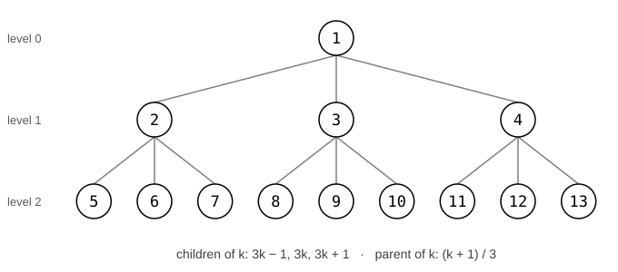

# Homework 5: Heaps

In this assignment you'll:

- finish the book's binary-heap priority queue by writing `swim` and `sink`
- build a **3-ary heap**, where every node has three children instead of two
- implement heapsort
- trace heapsort by hand, and compare how much work the two kinds of heap do

| | Due | What's due |
|---|---|---|
| Homework 5 | Monday, November 9 | Parts 1–5 |

## Starter code

Download [`hw5-starter.zip`](https://github.com/ben-allen/CIS-023/blob/main/assignments/heaps/hw5-starter.zip) from the course repo. Open the link and click the download button (the downward arrow) near the top right of the file view. **Don't unzip it.**

## Setup

Same steps as Homework 4:

1. In Eclipse's Package Explorer, right-click your project's `src` folder and choose **Import…**
2. Choose **General → Archive File**, and click **Next**.
3. Click **Browse…** and select `hw5-starter.zip`.
4. Check that **Into folder** says *your project's name*`/src`.
5. Click **Finish**.

You should now see a package called `hw5` inside `src`, with five files in it:

| File | What it is |
|---|---|
| `MaxPQ.java` | The book's binary-heap priority queue. **You write `swim` and `sink`.** |
| `MaxPQ3.java` | The same priority queue as a 3-ary heap. **You write `swim`, `largestChild`, and `sink`.** |
| `Heap.java` | Heapsort. **You write `buildHeap`, `sort`, and `sink`.** |
| `HW5Client.java` | Tests Parts 1–3. |
| `HeapCompare.java` | The experiment for Part 5. |

Right-click `HW5Client.java` and choose **Run As → Java Application**. Every test should say `FAIL` for now, ending with `0 of 13 tests passed`. That's expected.

**If your computer unzipped the file automatically**, drag the `hw5` folder onto your project's `src` folder in Eclipse, and choose **Copy files and folders**.

**Yellow warning triangles are expected**, just like in HW4.

### The rules

- **Every comparison goes through `less()`**, and **every exchange goes through `exch()`**, just like the sorts.
- **The heap counts from 1.** The keys live in `pq[1..n]`, and `pq[0]` is never used.
- `HW5Client` is known to be correct. If a test fails, the bug is in your code, not the client.

---

## Part 1: `swim` and `sink`

Everything in `MaxPQ.java` is done except `swim` and `sink`. Read `insert` and `delMax` first, since they're the methods that call yours. In a binary heap, the parent of `k` is `k/2`, and its children are `2k` and `2k+1`.

### `swim(k)`

`insert` puts the new key at the end of the heap, in `pq[n]`, then calls `swim(n)`. Here's the pseudocode from the slides:

```
while k > 1 and pq[k/2] is less than pq[k]:
    exchange pq[k/2] and pq[k]
    k = k/2
```

"is less than" is `less(k/2, k)`, and "exchange" is `exch(k/2, k)`. Notice that `less` and `exch` take **indices**, not keys.

### `sink(k)`

`delMax` moves the last key to the root, then calls `sink(1)`. Here's the pseudocode:

```
while k has a child (2*k <= n):
    j = 2*k                                        (the left child)
    if j has a right sibling (j < n) and pq[j] is less than pq[j+1]:
        j = j + 1                                  (use the right child: it's larger)
    if pq[k] is not less than pq[j]: stop          (k is big enough)
    exchange pq[k] and pq[j]
    k = j
```

The order of the conditions matters. `j < n` has to be checked before `less(j, j + 1)`. The book writes the "stop" line as `if (!less(k, j)) break;`.

Run `HW5Client`. Tests 1–4 should pass. Tests 1–3 are the traces from the slides, so if one fails, you can compare your result against the slides step by step.

**If you're stuck:**

| If you see... | Check... |
|---|---|
| `NullPointerException` in `swim` | that the loop stops at the root: `k > 1`, not `k >= 1`. At `k = 1`, `k/2` is 0, and `pq[0]` is empty |
| Test 1 fails, and S never moved | that `swim` actually exchanges and then sets `k = k/2` |
| Test 2 fails, and a key you already removed shows up again | the `j < n` check in `sink`. Without it, `sink` can reach past the end of the heap into the slot `delMax` just gave up |
| Tests 2–4 fail, and the order looks almost right | that you move `j` to the **larger** child: `less(j, j + 1)`, not `less(j + 1, j)` |
| The program never finishes | that `sink` sets `k = j` after each exchange, and `swim` sets `k = k/2` |

## Part 2: A 3-ary heap

Nothing about a heap says each node has to have **two** children. In a **3-ary heap**, each node has up to three, and the tree is filled level by level, left to right, just like before:



Heap order is the same rule: every parent is at least as big as its children. So the largest key is still at the root, and `insert` and `delMax` (already done for you) work exactly the same way. Only `swim` and `sink` need to know the tree's new shape.

**The index arithmetic is done for you.** `MaxPQ3.java` has four helper methods, the same way `less` and `exch` handle comparing and swapping:

| Method | Returns |
|---|---|
| `parent(k)` | the index of `k`'s parent |
| `firstChild(k)` | the index of `k`'s first (leftmost) child |
| `lastChild(k)` | the index of `k`'s last child that's actually in the heap (a node near the bottom may have only one or two) |
| `hasChild(k)` | whether `k` has any children at all |

Use these, and you'll never have to work out a `3k - 1` yourself. When you run `HW5Client`, it prints a few of them first, so you can check them against the picture.

Write the three methods in this order. Each one builds on the one before.

**1. `swim(k)`.** This is your `MaxPQ` swim, with `k/2` replaced by `parent(k)` everywhere. That's the only change: swimming up a tree doesn't care how many children each node has.

**2. `largestChild(k)`.** This is the one genuinely new piece. It returns the index of the largest of `k`'s children:

```
best = firstChild(k)
for each child c from firstChild(k) + 1 up to and including lastChild(k):
    if pq[best] is less than pq[c]:
        best = c
return best
```

It's the same idea as finding the largest item in an array, except it only looks at `k`'s children. In the binary heap, this was the one line `if (j < n && less(j, j + 1)) j++;`. With up to three children, it needs a loop.

**3. `sink(k)`.** This is your `MaxPQ` sink, with two changes:

- The loop condition is `while (hasChild(k))`.
- The two lines that pick the larger child become `int j = largestChild(k);`.

The rest is the same: stop if `pq[k]` isn't less than `pq[j]`, otherwise exchange them and set `k = j`.

Run `HW5Client`. Tests 5–9 should pass. Test 5 checks `largestChild` by itself, so if it fails, fix that before looking at the others.

**If you're stuck:**

| If you see... | Check... |
|---|---|
| Test 5 gives `3 6 8 11` | that your loop goes **up to and including** `lastChild(k)`: `c <= lastChild(k)`, not `c <`. You're skipping the last child |
| `ArrayIndexOutOfBoundsException` in `largestChild` | that the loop stops at `lastChild(k)`, which stops at `n`, and not at `3 * k + 1` |
| Some of tests 6–9 fail, but tests 1–5 pass | that `swim` uses `parent(k)` in all three places, not `k / 2` |
| `ArrayIndexOutOfBoundsException` in `sink` | that the loop condition is `hasChild(k)`. Without it, `sink` calls `largestChild` on a node with no children |
| A key you already removed shows up again | the same as in Part 1: something is reaching past `n`. Check that you use `lastChild(k)` and `hasChild(k)` |

## Part 3: Heapsort

Fill in `buildHeap`, `sort`, and `sink` in `Heap.java`. Heapsort uses a binary heap, like Part 1.

Heapsort sorts a Java array, which counts from 0, but the heap logic counts from 1. The book handles this inside `less` and `exch`: heap index `k` is stored in `a[k-1]`, and those two methods do the subtracting for you. They're already written. So in `buildHeap`, `sort`, and `sink`, **think in heap indices 1 to n**, and never write `- 1` yourself.

**`sink(a, k, n)`** is the same as `MaxPQ`'s `sink`, with two differences:

- The heap size `n` is a parameter, because the heap shrinks during phase 2.
- `less` and `exch` take the array too: `less(a, j, j + 1)` and `exch(a, k, j)`.

**`buildHeap(a)`** is phase 1:

```
n = a.length
for k from n/2 down to 1:
    sink(a, k, n)
```

**`sort(a)`** is the whole sort:

```
buildHeap(a)
k = n
while k > 1:
    exchange a[1] and a[k]     (heap indices: the max goes to its final spot)
    k = k - 1                  (the heap is now one smaller)
    sink(a, 1, k)
```

(The book's `Heap.sort` writes phase 1 inside `sort`. It's split out here so `HW5Client` can check phase 1 on its own.)

Run `HW5Client`. Tests 10–13 should pass, and the last line should say `13 of 13 tests passed`.

**If you're stuck:**

| If you see... | Check... |
|---|---|
| `ArrayIndexOutOfBoundsException: Index 11` (or `Index -1`) | that you call `less` and `exch` and never index `a[]` directly. They do the `- 1` for you |
| Test 10 fails | that the loop starts at `n/2` and goes **down** to 1, including 1 |
| Test 10 passes, but test 11 is almost sorted | that phase 2 calls `sink(a, 1, k)` with the **shrinking** heap size `k`, not `a.length`. Sinking into the sorted part undoes your work |
| Test 11's array is sorted except the first two items | that the phase 2 loop runs while `k > 1` |

## Part 4: Trace heapsort by hand

In a plain text file called `heaptrace.txt`, answer the following. Start with this array:

```
H E A P S O R T I N G
```

1. Write the array after each call to `sink` in **phase 1**. Use this format, one line per call:

   ```
   sink(5): [H, E, A, P, S, O, R, T, I, N, G]
   sink(4): ...
   ```

   (The first line is done for you.) Drawing the tree for each step is the easiest way to get these right.

2. Which call in phase 1 didn't move anything? In a sentence, explain why.
3. Do the first **two** rounds of phase 2. After each round (one exchange and one `sink`), write the heap part and the sorted part:

   ```
   round 1: [heap part] | [sorted part]
   round 2: ...
   ```

Work these out by hand first. Then you're welcome to check phase 1 by calling `Heap.buildHeap` and `Heap.show` on the array.

## Part 5: Two heaps, compared

Run `HeapCompare`. It counts the compares your binary heap and your 3-ary heap make doing the same work: inserting n keys in increasing order (so every new key swims all the way to the root), then calling `delMax` n times.

In a plain text file called `compare.txt`, answer the following.

1. Paste the output into the file.
2. Tests 1 and 6 both insert `S` into the same array, `T P R N H O A E I G`, and in both heaps `S` starts at index 11. Draw both trees (binary and 3-ary). What is `S`'s parent in each tree? Why did the 3-ary heap need fewer exchanges to get `S` into place?
3. Look at the **insert** compares. About what fraction of the binary heap's compares does the 3-ary heap use? In a sentence or two, explain why, thinking about how tall each tree is and what one level of `swim` costs.
4. Now look at the **delMax** compares. The 3-ary tree is just as short, but the savings are much smaller. Why? (Hint: count the compares one level of `sink` makes in each kind of heap.)

## Points

This assignment is worth 20 points.

| Part | Points |
|---|---|
| Part 1: `MaxPQ` `swim` and `sink` (tests 1–4) | 4 |
| Part 2: `MaxPQ3` (tests 5–9) | 7 |
| Part 3: heapsort (tests 10–13) | 4 |
| Part 4: `heaptrace.txt` | 3 |
| Part 5: `compare.txt` | 2 |

## Submission checklist

- [ ] All `.java` files start with `package hw5;` and are in the `hw5` package. `hw5` should be lowercase
- [ ] Every comparison uses `less()`, and every exchange uses `exch()`
- [ ] Running `HW5Client` shows `13 of 13 tests passed`
- [ ] `heaptrace.txt` answers questions 1–3 in the formats shown
- [ ] `compare.txt` includes your `HeapCompare` output and answers questions 2–4
- [ ] Upload these files individually: `MaxPQ.java`, `MaxPQ3.java`, `Heap.java`, `heaptrace.txt`, and `compare.txt`
